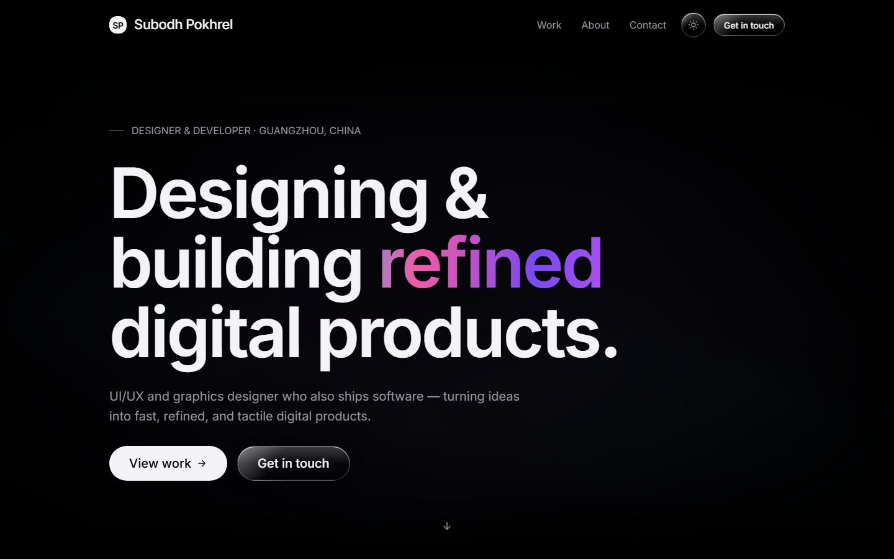
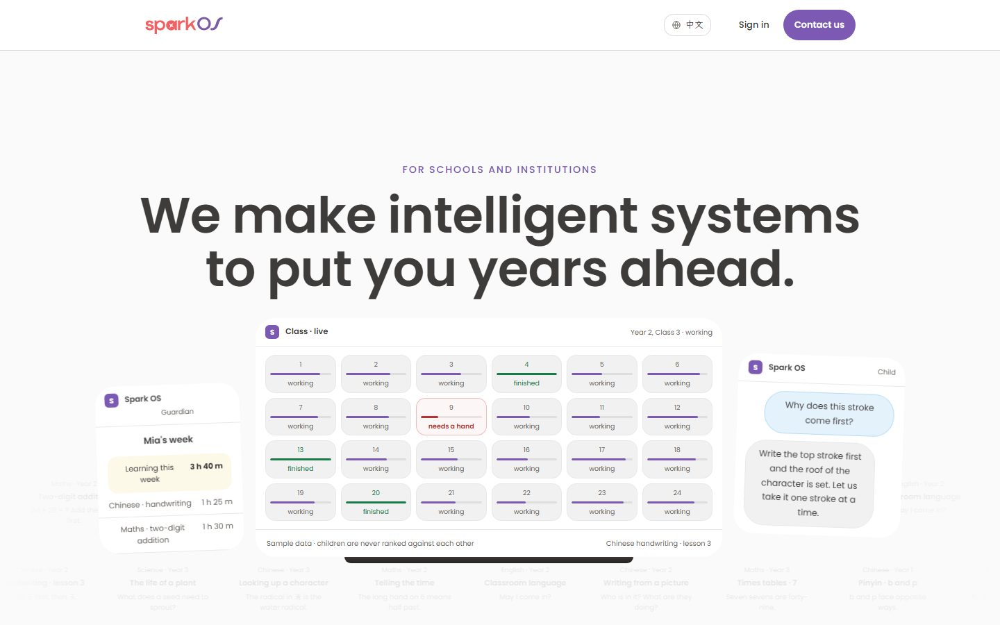
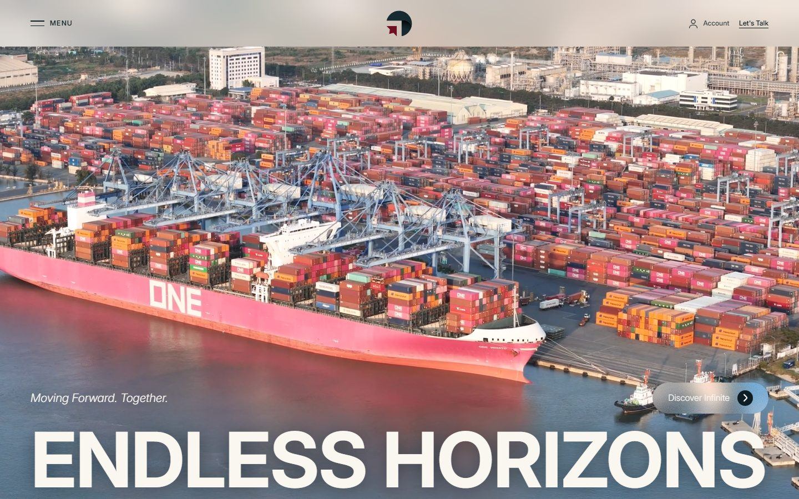
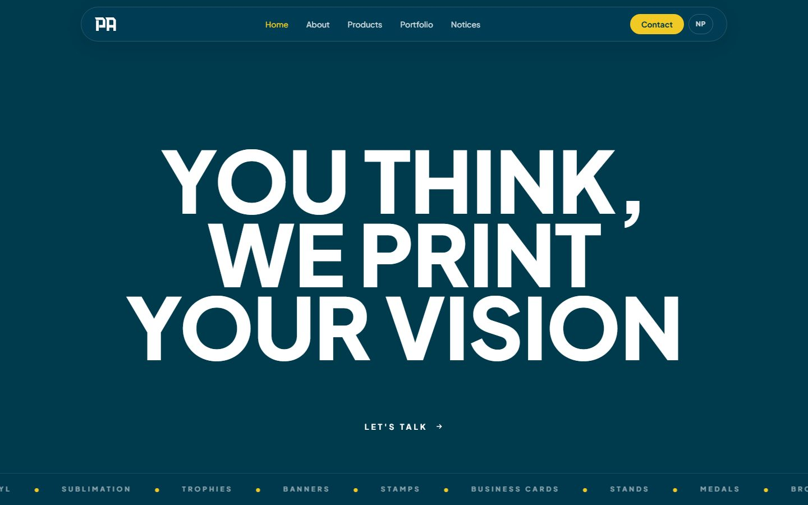
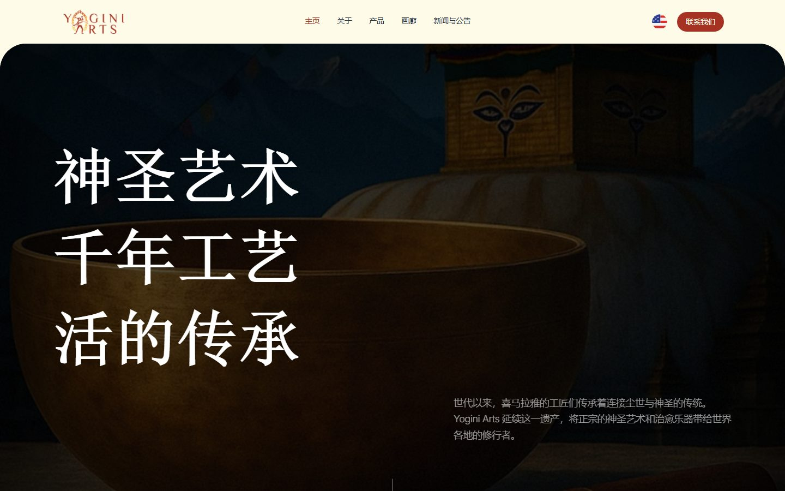

<a href="https://subodhpokhrel.com">
  <picture>
    <source media="(prefers-color-scheme: dark)" srcset="assets/banner-dark.svg">
    <source media="(prefers-color-scheme: light)" srcset="assets/banner-light.svg">
    
  </picture>
</a>

  <a href="https://subodhpokhrel.com"><b>Portfolio</b></a>&nbsp;&nbsp;·&nbsp;&nbsp;
  <a href="https://subodhpokhrel.com/work">Work</a>&nbsp;&nbsp;·&nbsp;&nbsp;
  <a href="https://subodhpokhrel.com/about">About</a>&nbsp;&nbsp;·&nbsp;&nbsp;
  <a href="https://subodhpokhrel.com/contact">Contact</a>

 

I'm a **UI/UX and graphics designer who also ships software**. I take products from the first wireframe and brand system all the way to a fast, production-grade frontend.

- **Design** — interfaces, brand systems, design systems and motion
- **Build** — React, Next.js, TypeScript and Tailwind CSS
- **Now** — Designer & Developer at SparkOS, based in Guangzhou, China
- **Open to** — select freelance work and collaborations

 

## Selected work

**[subodhpokhrel.com](https://subodhpokhrel.com)** — My portfolio, designed and built from scratch: a hand-written WebGL aurora, a token-based design system, and first-class light and dark themes.

 

<table>
  <tr>
    <td width="50%" valign="top">
      
      
<b><a href="https://spark-os.com">Spark OS</a></b> · 2025 
      Website for an all-in-one school platform — classwork, marking, and a live view of every class.

    </td>
    <td width="50%" valign="top">
      
      
<b><a href="https://ansportia.com">Ansportia</a></b> · 2025 
      Site for a global sourcing, quality-control and logistics partner shipping across six countries.

    </td>
  </tr>
  <tr>
    <td width="50%" valign="top">
      
      
<b><a href="https://pokhrelflexprinting.com">Pokhrel Flex Printing</a></b> · 2024 
      Bold brand and services site for a print studio — vinyl, sublimation, trophies, medals and more.

    </td>
    <td width="50%" valign="top">
      
      
<b><a href="https://yoginiarts.com">Yogini Arts</a></b> · 2024 
      Chinese and English site for sacred Himalayan art and sound instruments.

    </td>
  </tr>
</table>

 

## Toolkit

<picture>
  <source media="(prefers-color-scheme: dark)" srcset="https://skillicons.dev/icons?i=figma%2Creact%2Cnextjs%2Cts%2Ctailwind%2Cjs%2Chtml%2Ccss%2Cpython%2Cnodejs%2Cwordpress%2Cgit%2Cdocker%2Cvercel%2Clinux&perline=8&theme=dark">
  <source media="(prefers-color-scheme: light)" srcset="https://skillicons.dev/icons?i=figma%2Creact%2Cnextjs%2Cts%2Ctailwind%2Cjs%2Chtml%2Ccss%2Cpython%2Cnodejs%2Cwordpress%2Cgit%2Cdocker%2Cvercel%2Clinux&perline=8&theme=light">
  
</picture>

**Design** — UI/UX · Graphic design · Design systems · Branding · Prototyping 
**Frontend** — React · Next.js · TypeScript · Tailwind CSS · HTML & CSS · Motion 
**Backend & CMS** — Python · Node.js · WordPress · REST APIs 
**Tooling** — Git · Docker · CI/CD · Vercel · Linux

 

## Let's work together

Have a product, brand or website in mind? **[Get in touch →](https://subodhpokhrel.com/contact)**

 

My client and personal code lives in private repositories — the live sites above are the best way to see the work.
