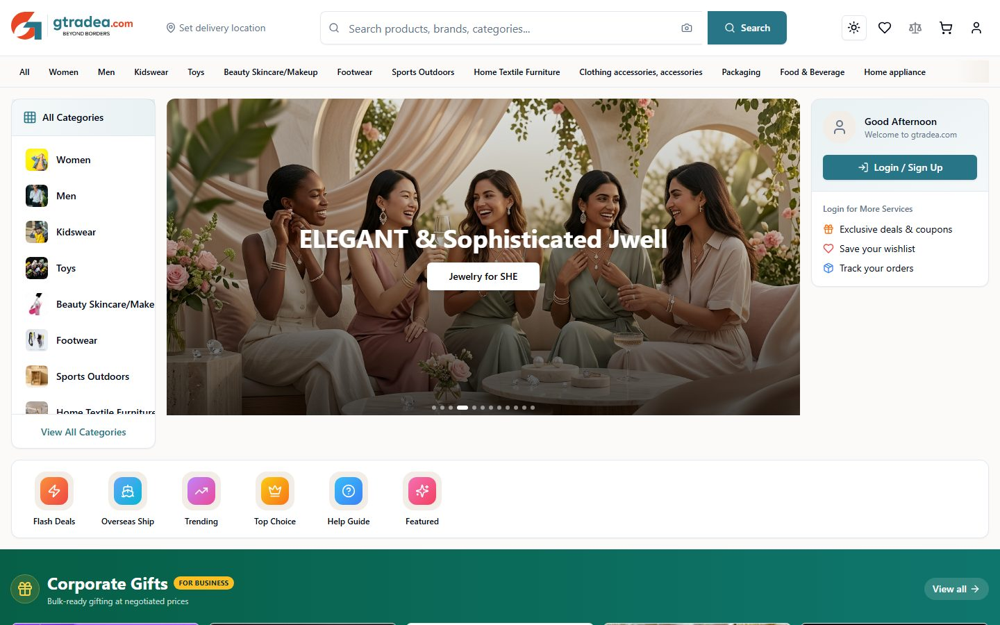

<a href="https://subodhpokhrel.com">
  <picture>
    <source media="(prefers-color-scheme: dark)" srcset="assets/banner-dark.svg">
    <source media="(prefers-color-scheme: light)" srcset="assets/banner-light.svg">
    
  </picture>
</a>

<p align="center">
  <a href="https://subodhpokhrel.com"><b>Portfolio</b></a>&nbsp;&nbsp;·&nbsp;&nbsp;
  <a href="https://subodhpokhrel.com/work">Work</a>&nbsp;&nbsp;·&nbsp;&nbsp;
  <a href="https://subodhpokhrel.com/about">About</a>&nbsp;&nbsp;·&nbsp;&nbsp;
  <a href="https://subodhpokhrel.com/contact">Contact</a>
</p>

<br>

I'm a **UI/UX and graphics designer who also ships software**. I take products from the first wireframe and brand system all the way to a fast, production-grade frontend — and the APIs, databases and pipelines behind it.

- **Design** — interfaces, brand systems, design systems and motion
- **Build** — React, Next.js and TypeScript on the front; Node.js, NestJS and PostgreSQL behind
- **Now** — Designer & Developer at SparkOS in Guangzhou, China · building the Infeca group web app
- **Open to** — select freelance work and collaborations

<br>

## Selected work

<a href="https://subodhpokhrel.com">
  
</a>

**[subodhpokhrel.com](https://subodhpokhrel.com)** · 2026 &nbsp;<br>
My portfolio, designed and built from scratch: a hand-written WebGL aurora, a token-based design system, and first-class light and dark themes.<br>
<code>Next.js</code> <code>React</code> <code>Tailwind CSS</code> <code>WebGL</code> <code>Playwright</code>

<br>

<table>
  <tr>
    <td width="50%" valign="top">
      <a href="https://spark-os.com"></a>
      <p><b><a href="https://spark-os.com">Spark OS</a></b> · 2025 &nbsp;<br>
      <sub>All-in-one school platform — classwork, marking, and a live view of every class.</sub><br>
      <code>React</code> <code>Vite</code> <code>Three.js</code> <code>Express</code> <code>MongoDB</code> <code>Redis</code> <code>OpenAI</code></p>
    </td>
    <td width="50%" valign="top">
      <a href="https://ansportia.com"></a>
      <p><b><a href="https://ansportia.com">Ansportia</a></b> · 2025 &nbsp;<br>
      <sub>Brand site and cloud trading-management system for Nepal–China imports and exports — orders, suppliers, payments and documents.</sub><br>
      <code>Next.js</code> <code>NestJS</code> <code>Prisma</code> <code>Supabase</code> <code>Three.js</code></p>
    </td>
  </tr>
  <tr>
    <td width="50%" valign="top">
      <a href="https://gtradea.com"></a>
      <p><b><a href="https://gtradea.com">gtradeA</a></b> · 2026 &nbsp;<br>
      <sub>Cross-border online store — fashion, toys, beauty, home and corporate gifts, shipped beyond borders.</sub><br>
      <code>E-commerce</code> <code>Catalog &amp; search</code> <code>Accounts &amp; cart</code></p>
    </td>
    <td width="50%" valign="top">
      
      <p><b>Infeca</b> · 2026 &nbsp;<br>
      <sub>Web app for the Infeca group of companies — the parent of Ansportia, spanning trading and furniture.</sub><br>
      <code>Next.js</code> <code>NestJS</code> <code>Prisma</code> <code>Supabase</code></p>
    </td>
  </tr>
  <tr>
    <td width="50%" valign="top">
      <a href="https://pokhrelflexprinting.com"></a>
      <p><b><a href="https://pokhrelflexprinting.com">Pokhrel Flex Printing</a></b> · 2024 &nbsp;<br>
      <sub>Bold brand and services site for a print studio — vinyl, sublimation, trophies, medals and more.</sub><br>
      <code>React</code> <code>Vite</code> <code>GSAP</code> <code>Express</code> <code>PostgreSQL</code></p>
    </td>
    <td width="50%" valign="top">
      <a href="https://yoginiarts.com"></a>
      <p><b><a href="https://yoginiarts.com">Yogini Arts</a></b> · 2024 &nbsp;<br>
      <sub>Chinese and English site for sacred Himalayan art and sound instruments.</sub><br>
      <code>React</code> <code>Vite</code> <code>i18next</code> <code>Node.js</code></p>
    </td>
  </tr>
</table>

<br>

## How I ship

```bash
$ git switch -c feat/checkout-redesign     # one branch per feature
$ pnpm lint && pnpm test && pnpm build     # ESLint · Vitest · Playwright · type-check
$ docker compose up -d                     # Postgres · Redis · Nginx, running locally
$ gh pr create --fill                      # GitHub CLI → CI runs on GitHub Actions
$ gh pr merge --squash --delete-branch     # review, squash, merge
$ git push origin main                     # auto-deploys to production
```

<br>

## Toolkit

**Design** — UI/UX · graphic design · branding · design systems · prototyping

<picture>
  <source media="(prefers-color-scheme: dark)" srcset="https://skillicons.dev/icons?i=figma%2Cps%2Cai&theme=dark">
  <source media="(prefers-color-scheme: light)" srcset="https://skillicons.dev/icons?i=figma%2Cps%2Cai&theme=light">
  
</picture>

**Frontend** — plus Framer Motion · GSAP · TanStack Query · Radix UI · i18next

<picture>
  <source media="(prefers-color-scheme: dark)" srcset="https://skillicons.dev/icons?i=react%2Cnextjs%2Cvite%2Cts%2Cjs%2Ctailwind%2Cthreejs%2Chtml%2Ccss&theme=dark">
  <source media="(prefers-color-scheme: light)" srcset="https://skillicons.dev/icons?i=react%2Cnextjs%2Cvite%2Cts%2Cjs%2Ctailwind%2Cthreejs%2Chtml%2Ccss&theme=light">
  
</picture>

**Backend & data** — plus REST APIs · JWT auth · Zod · vector search (pgvector, Qdrant) · OpenAI API

<picture>
  <source media="(prefers-color-scheme: dark)" srcset="https://skillicons.dev/icons?i=nodejs%2Cnestjs%2Cexpress%2Cprisma%2Cpostgres%2Cmongodb%2Credis%2Csupabase%2Cpy&theme=dark">
  <source media="(prefers-color-scheme: light)" srcset="https://skillicons.dev/icons?i=nodejs%2Cnestjs%2Cexpress%2Cprisma%2Cpostgres%2Cmongodb%2Credis%2Csupabase%2Cpy&theme=light">
  
</picture>

**DevOps & tooling** — plus Git & GitHub CLI · Docker Compose · CI/CD · AWS S3

<picture>
  <source media="(prefers-color-scheme: dark)" srcset="https://skillicons.dev/icons?i=git%2Cgithub%2Cgithubactions%2Cdocker%2Cnginx%2Caws%2Cvercel%2Clinux%2Cbash%2Cvscode%2Cpnpm&theme=dark">
  <source media="(prefers-color-scheme: light)" srcset="https://skillicons.dev/icons?i=git%2Cgithub%2Cgithubactions%2Cdocker%2Cnginx%2Caws%2Cvercel%2Clinux%2Cbash%2Cvscode%2Cpnpm&theme=light">
  
</picture>

**Testing & quality** — Vitest · Playwright · Testing Library · Storybook · jest-axe (accessibility) · ESLint · Prettier · Husky

<br>

## Let's work together

Have a product, brand or website in mind? **[Get in touch →](https://subodhpokhrel.com/contact)**

<br>

<sub>My client and personal code lives in private repositories — the live sites above are the best way to see the work.</sub>
